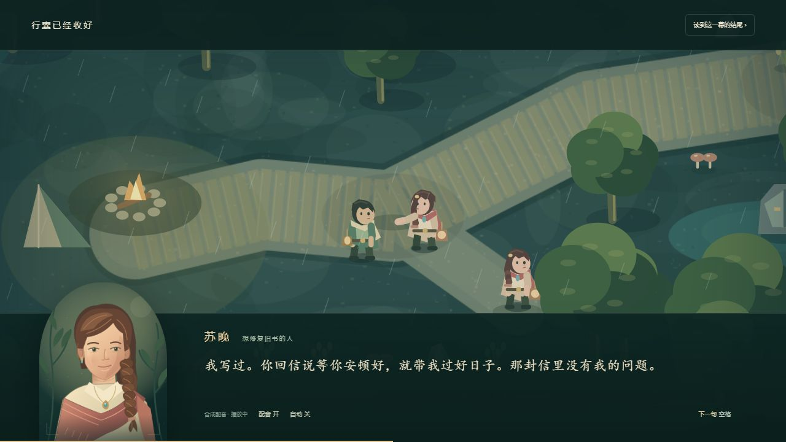
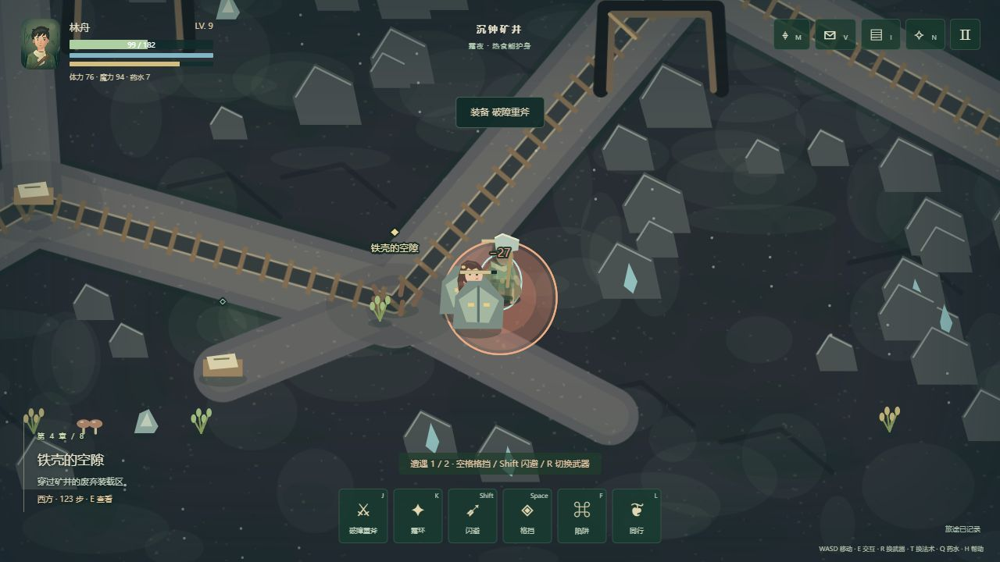
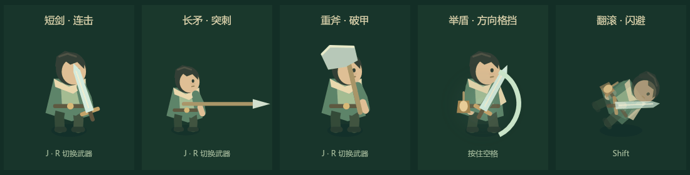

# 苔灯之森 · 长夜与归途

**一个关于亲情、爱情与告别的中文俯视角动作 RPG。** 玩家扮演离家三年的林舟，循着父亲的家书，穿过村庄、旧林、矿井与海港，寻找失联的弟弟，也重新认识母亲和爱人各自的人生。

游戏以故事探索和战术战斗为主，种植、烹饪、修建为冒险提供补给。使用原生 HTML、CSS、Canvas 2D 与 Web Audio 开发，下载后即可在浏览器中游玩，无需游戏引擎、账号或付费 API。

> **当前状态：可试玩的开发版。** 已接通八章主线与结局；约 10 小时是后续扩展目标，尚未经过完整人工通关计时。配音为中文合成语音，演出为实时 2D 动画。



## 1. 游戏里有什么

| 内容 | 当前实现 |
|---|---|
| 剧情 | 8 章、48 个主线节点、12 条三阶段人物支线；选择影响人物关系及后日谈 |
| 探索 | 8 个地区，可返回已解锁地图；手札保存任务和做过的选择 |
| 战斗 | 短剑、长矛、重斧；体力、方向格挡、精准招架、闪避、陷阱、同行援助 |
| 敌人与法术 | 6 类敌人；火、霜、雷与天气互动；25 场目标战斗，含 9 场守灯与 3 场首领战 |
| 解谜与成长 | 13 个谜题；经验升级，剑心、流萤、守望三条天赋路线 |
| 家园 | 种植、烹饪、药水与工具制作、4 类修建；作物随行动与休息成长 |
| 演出与声音 | 人物立绘、分肢体动作、运镜与字幕；322 句本地中文合成配音 |
| 存档 | 浏览器本地自动存档，记录故事选择、成长、家园及战斗检查点 |



## 2. 怎样开始游玩

### 直接打开，无需安装依赖

下载仓库的 ZIP 并**完整解压**，然后：

- Windows：双击根目录的 **`开始长篇.cmd`**。
- 其他系统：使用现代 Chrome、Edge 或 Firefox 打开 **`journey.html`**。

游戏脚本和配音均在本地。请保留 `src/` 与 `assets/`，不要只下载一个 HTML 文件。浏览器可能需要首次点击后才能播放声音。

### 使用本地服务器

如果浏览器限制文件页面的音频或存储，可安装 Python 3，在项目根目录执行：

```bash
python serve.py
```

再打开 [http://127.0.0.1:4178/journey.html](http://127.0.0.1:4178/journey.html)。服务只监听本机；这个地址在启动本地服务后才可使用，GitHub 仓库页面本身不是在线游戏站点。

### 仓库里的两个入口

| 版本 | 入口 | 用途 |
|---|---|---|
| **长夜与归途** | `journey.html` / `开始长篇.cmd` | 当前主要开发的八章版本，建议先玩这个 |
| 归途来信 | `index.html` / `开始冒险.cmd` | 保留的独立短篇，包含音乐盒、护灯同行、星镜和完整结局 |

两版使用独立存档。存档保存在当前浏览器中，**不上传 GitHub**。文件入口、`localhost`、`127.0.0.1` 和不同端口之间不共享存档；继续游戏请使用同一入口。清除浏览器站点数据会清除进度。

## 3. 操作与玩法

以下为长篇操作；短篇的空格键用于攻击。

| 按键 | 操作 |
|---|---|
| WASD / 方向键 | 移动 |
| E | 交谈、调查、采集，或在营地打开生活菜单 |
| J / R | 攻击 / 切换武器 |
| 空格 / Shift | 持续格挡 / 闪避 |
| K / T | 施法 / 切换火、霜、雷 |
| F / L / Q | 布置陷阱 / 同行共鸣 / 使用药水 |
| M / V | 地图 / 任务与回忆手札 |
| I / N | 行囊 / 天赋 |
| H / Esc | 帮助 / 暂停 |
| 演出中的空格、E 或 Enter | 下一句对白 |

靠近金色任务标记后按 E；战斗结束后回到标记处再按 E，阅读线索继续故事。每章结束可前往下一地区，也可以留下完成支线。菜单和剧情演出会暂停战斗，切换窗口会自动暂停。

短剑灵活，长矛适合保持距离，重斧适合破甲。攻击、格挡和翻滚都需要管理体力；观察敌人的地面预警，给收招与撤退留出空间。营地位于各地区西南侧，可以料理、修建、种植与休息。更多细节见 [试玩说明](design/journey-play-guide.md)。

## 4. 剧情与画面资料

故事围绕未寄出的家书、旧矿难、母亲留下的歌和苏晚的求学计划展开。结局温暖但有遗憾；人物的选择会在之后的生活中留下回响。

- [完整剧情、人物关系与结局](design/完整剧情.md)（包含全部剧透）。
- [全部对白与分支](design/完整对白.md)（322 句对白，另附 21 段条件后日谈）。
- [八章内容规划与时长目标](design/long-campaign.md)。
- [八地区画面概览](production/qa/journey-regions-overview.png)。

下面的动作对照使用实际角色渲染器生成，用于展示武器和动作区别，并非实战录屏：



## 5. 工程结构

```text
journey.html / journey.css  长篇页面入口与样式
index.html / styles.css    独立短篇入口与样式
src/                      剧情数据、核心逻辑、画面、声音与界面
assets/journey-voice/      长篇 MP3 与统一配音清单
assets/voice/              短篇 MP3 与统一配音清单
design/                   玩法设计、美术规范、剧情与对白
tests/                    核心回归测试及本地浏览器场景夹具
tools/                    对白导出、内容统计、配音生成和验证工具
production/audio/         音效规范、配音来源与验证记录
production/qa/            验证报告与精选截图、动作预览
serve.py                  仅供本机使用的静态服务器
```

游戏运行不需要 Node.js、Python 包或构建步骤。历史版本由 Git 记录；仓库不保存旧版 ZIP、临时安装目录、上传脚本、服务日志或渲染中间帧。

## 6. 开发与验证

使用 Node.js 20 或更新版本，在项目根目录运行：

```bash
node --test tests/core.test.cjs tests/story.test.cjs tests/voice.test.cjs tests/journey-data.test.cjs tests/journey.test.cjs
node tools/export-journey-story.cjs --check
```

更新游戏对白后，执行 `node tools/export-journey-story.cjs` 重新导出对白文档；`node tools/journey-content-report.cjs` 更新内容统计。

配音文件校验需要 Python 3 与 Node.js，仅使用 Python 标准库：

```bash
python tools/validate-voice.py
python tools/validate-journey-voice.py
```

生成新配音需要网络及可选开发依赖；现有 MP3 无需重新生成即可游玩：

```bash
python -m venv .venv
# Windows: .venv\Scripts\activate
# macOS / Linux: source .venv/bin/activate
python -m pip install -r tools/requirements-voice.txt
python tools/generate-journey-voice.py
```

短篇生成命令为 `python tools/generate-voice.py`。生成器按文本和声线配置从统一清单恢复缓存，不重复生成未变化的台词。Node.js 默认从 PATH 查找，也可通过 `MOSSLIGHT_NODE` 指定。

可选动作预览工具：安装 `npm install --no-save --package-lock=false @napi-rs/canvas@0.1.100`，运行 `node tools/render-journey-actions.cjs` 或 `node tools/render-actions.cjs`。输出的 PNG 中间帧不会提交到 Git。

浏览器场景夹具位于 `tests/journey-fixtures.html` 与 `tests/browser-fixtures.html`，仅允许使用 `localhost` 测试域名。它们会替换该测试域名的存档，用于快速验证指定场景。

## 7. 完成度与后续方向

当前 47 项核心测试通过，360 句长短篇配音资源通过完整帧与文本指纹校验。另已分场景检查剧情选择、营地、天赋、存档、实战输入和结局。详细证据与边界见 [长篇验证报告](production/qa/journey-verification.md) 和 [短篇验证记录](production/qa/verification.md)。

全流程任务图检查使用程序推进部分战斗，不能代替人工首通。仍需完成：更丰富的独立场景与任务、完整游玩节奏和时长测量、更多玩家的战斗平衡反馈、逐句配音听感审校，以及触屏适配验证。

## 8. 技术与资源来源

场景、角色、立绘由 Canvas 绘制；配乐和音效使用 Web Audio 合成。中文配音来自 Microsoft Edge Read Aloud 神经语音，通过 `edge-tts` 生成成本地 MP3，属于合成配音。来源与配置见 [长篇配音记录](production/audio/journey/voice-report.md) 和 [短篇配音记录](production/audio/story/voice-report.md)。

开发流程参考 [Claude Code Game Studios](https://github.com/Donchitos/Claude-Code-Game-Studios) 的美术、音效分工与验证方法；游戏本身不依赖该工具或完整模板。美术与音效约束保存在 [美术规范](design/art/art-bible.md) 和 [声音设计](production/audio/combat/sfx-spec.md)。
